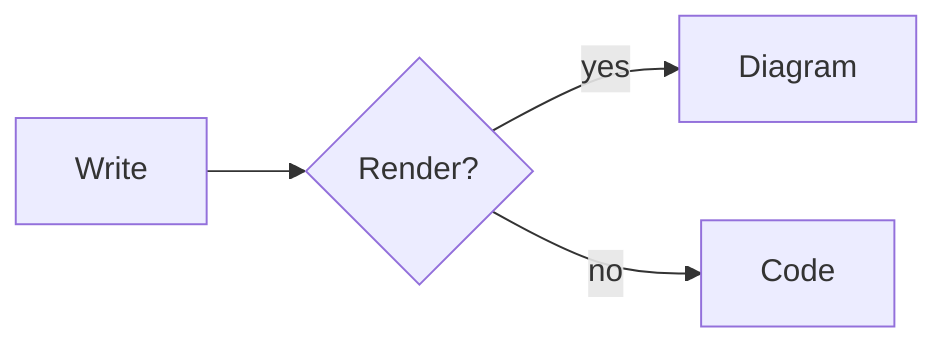

# Diagrams



```sequence
Alice->Bob: Hello Bob
Note right of Bob: Bob thinks
Bob-->Alice: I am good
```

```flow
st=>start: Start
op=>operation: Edit
cond=>condition: Done?
e=>end: End
st->op->cond
cond(yes)->e
cond(no)->op
```

Last paragraph.
