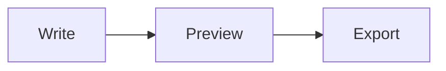

# Markdown Reference

Marpora reads and writes [GitHub Flavored Markdown](https://github.github.com/gfm/), plus math, diagrams, footnotes, alerts and front matter. This page is itself Markdown: open **View › Source Code Mode** (⌘/) to see the source of each example.

[TOC]

## Block Elements

### Paragraphs and Line Breaks

A paragraph is one or more lines of text. Press Return for a new paragraph and ⇧Return for a line break inside one.

A single newline in the file is a soft break. By default it shows as a line break while you edit and as a space in exports. **Edit › Whitespace and Line Breaks** changes how soft breaks and `<br/>` tags show.

### Headings

```markdown
# Heading 1
## Heading 2
###### Heading 6
```

Type `#` and a space at the start of a line, or use ⌘1 to ⌘6.

### Quotes

> A quote starts with `>` and a space.
>
> > Quotes can be nested.

### Alerts

> [!NOTE]
> Useful information that users should know.

> [!WARNING]
> Urgent information that needs attention.

An alert is a quote whose first line is `[!NOTE]`, `[!TIP]`, `[!IMPORTANT]`, `[!WARNING]` or `[!CAUTION]`. They are also under **Paragraph › Alert**.

### Lists

- An unordered list starts with `-`, `*` or `+`.
- Press Tab to indent an item and ⇧Tab to outdent it.

1. An ordered list starts with a number and a period.
2. Numbering follows the first item.

### Task Lists

- [ ] A task starts with `- [ ]`.
- [x] Click the box, or press ⌃X, to tick it.

### Code Blocks

````markdown
```python
def greet(name):
    return f"Hello, {name}!"
```
````

Type three backticks and a language name, then press Return. The language box under the block changes the highlighting.

### Math Blocks

$$
\int_0^\infty e^{-x^2}\,dx = \frac{\sqrt{\pi}}{2}
$$

Type `$$` and press Return, or use ⌥⌘B. Math is TeX, rendered by MathJax. Numbered equations (`\begin{equation}`) can be turned off in Preferences.

### Diagrams



Code blocks in `mermaid`, `flow` (flowchart.js) and `sequence` (js-sequence-diagrams) draw diagrams.

### Tables

| Left | Center | Right |
| :--- | :----: | ----: |
| a    |   b    |     c |

Type a header row such as `| a | b |` and press Return, or use ⌥⌘T. The toolbar over a table adds rows and columns, sets alignment and resizes it.

### Footnotes

A footnote reference looks like this[^note].

[^note]: And the footnote text goes anywhere in the document.

### Horizontal Rules

Type `---` on its own line:

---

### Table of Contents

`[TOC]` on its own line lists the document's headings, as at the top of this page.

### YAML Front Matter

Three dashes on the first line of the document start a metadata block, as at the top of this file.

## Inline Elements

| Markdown                    | Result                    |
| --------------------------- | ------------------------- |
| `*emphasis*` or `_emphasis_` | *emphasis*                |
| `**strong**`                | **strong**                |
| `~~strike~~`                | ~~strike~~                |
| `` `code` ``                | `code`                    |
| `<u>underline</u>`          | <u>underline</u>          |
| `<!-- comment -->`          | (hidden in exports)       |

These are off by default. Turn them on in **Preferences › Markdown**:

| Markdown      | Result        |
| ------------- | ------------- |
| `==highlight==` | highlight   |
| `$x^2$`       | inline math   |
| `H~2~O`       | subscript     |
| `x^2^`        | superscript   |

### Links

- Inline: `[Marpora](https://example.com "title")`.
- Reference: `[Marpora][id]`, with `[id]: https://example.com` on a line of its own.
- Automatic: `<https://example.com>`, or a bare `www.example.com`.
- To a heading: `[Images](#images)`.

Hold ⌘ and click a link to open it.

### Images

``

Drag an image in, paste one, or use **Format › Image**. Where pasted images are stored is set in **Preferences › Image**.

### HTML

Inline HTML such as `<kbd>⌘</kbd>` or `<mark>marked</mark>` renders in place, and HTML blocks render as a whole. Scripts are not run.

### Escaping

A backslash shows a character literally, such as `\*not emphasis\*`.
